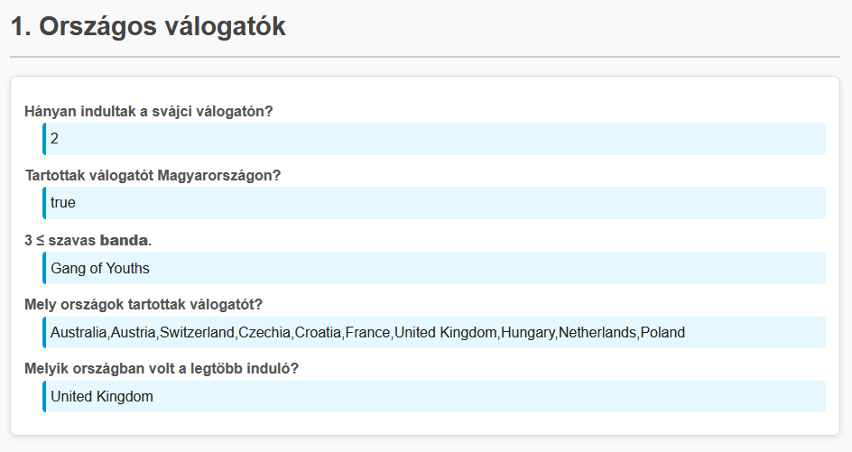
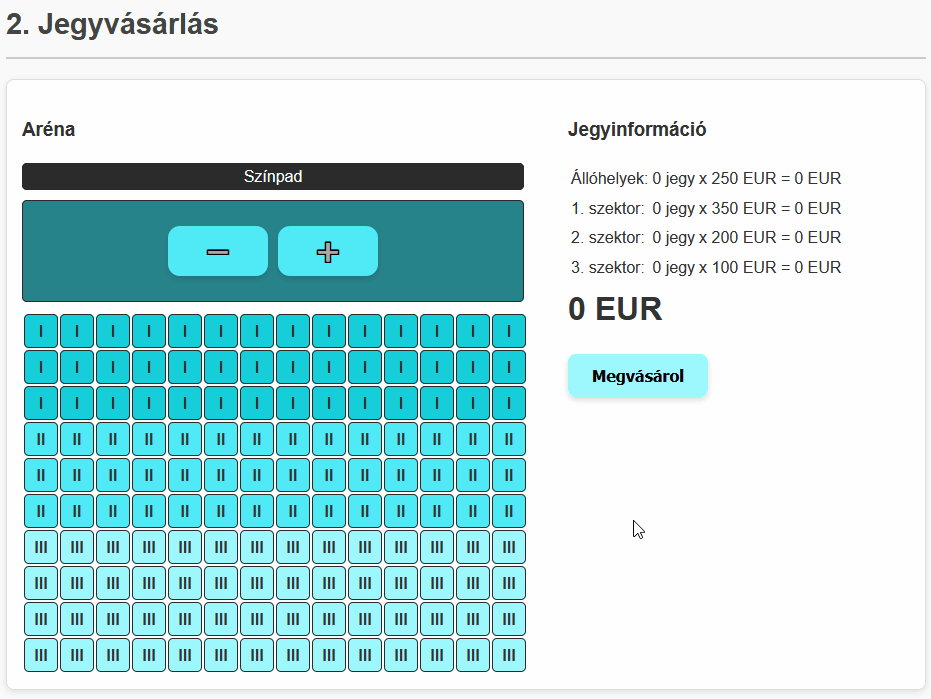
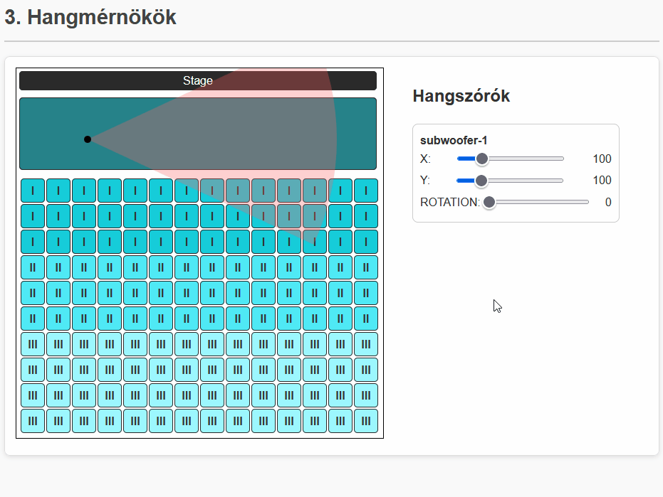

# JavaScript feladatok

## 1. Országos válogatók (js-1-selections, 10 pont)
Az Eurovízió válogatókat minden ország magának rendezi. Segíts az Eurovízió szervezőknek, hogy tudják, melyik országban mekkora volt a show! A feladatokat **ne beégetve oldd meg, hanem programozottan**, hiszen a szervezők még nem rendelkeznek a tényleges jövő évi indulók listájával!

*Az `index.js` fileban eléred a `participants` változót, amit a `participants.js` fileban definiáltunk, és a `nations` változót, amit a `nations.js` fileban definiáltunk. A `participants` tömb országok szerint rendezett.*

- a. (1 pont) A `taskA` azonosítójú elembe írd ki, hogy hányan indultak a svájci (`CHE`) válogatón!
- b. (1 pont) A `taskB` azonosítójú elembe írd ki, hogy Magyarország (`HUN`) tartott-e válogatót! (Másképp: Van induló magyar színekben?)
- c. (2 pont) A `taskC` azonosítójú elembe adj meg egy olyan induló bandát (`type`: `band`), aminek a neve legalább három szóból áll! (Másképp: Van benne minimum két szóköz.)
    - Feltételezheted, hogy van ilyen.
- d. (3 pont) A `taskD` azonosítójú elembe sorold fel azokat az országokat, akik tartottak válogatót! (Másképp: Listázd a `participants`-ban szereplő országokat.)
    - Ország**kódok** ismétlődésekkel: 1 pont
    - Ország**nevet** használva (`CHE` -> `Switzerland`): +1 pont
    - Ismétlődések nélkül (akár kóddal, akár névvel): +1 pont
- e. (3 pont) A `taskE` azonosítójú elembe írd ki, hogy melyik országból indult a legtöbb versenyző!
    - Maximum kiválasztás: 2 pont
    - Ország**nevet** használva (`CHE` -> `Switzerland`): +1 pont



## 2. Jegyvásárlás (js-2-ticket, 15 pont)
A 2026-os Eurovíziót Bécs egyik híres stadionjában fogják megrendezni. A jegyvásárlás egy különösen kényes pontja a rendezvénynek. A nézőtér több szektorra van osztva; valamint a színpad előtt csak állóhelyek találhatók. Minden szektorban más a jegyek ára.

- a. (1 pont) A `cost-info` azonosítójú táblában jelezd az egyes szektorok jegyeinek árát!
    - A `sector-0-cost`, `sector-1-cost`, `sector-2-cost`, `sector-3-cost` azonosítójú elemekbe kell beírnod a `sectorCosts` tömb értékeit.
    - A tömbindexek megegyeznek az árhoz tartozó szektor számával (pl.: `0` -> `#sector-0-cost`).
- b. (1 pont) A plusz gomb (`add-standing` azonosító) megnyomására növeld a megvásárolni kívánt állóhelyek számát a `cost-info` azonosítójú táblában!
    - A `sector-0-amount` azonosítójú elemben jelzed a jegyek számát!
    - A `sector-0-total` azonosítójú elembe számold ki az árat is! (`total = amount * cost`)
    - A mínusz gomb (`sub-standing`) hasonlóan működjön lefelé, de ne lehessen negatív számú jegyet venni!
- c. (3 pont) Generáld ki az ülőhelyeket a `seating` azonosítójú táblázatba!
    - Az ülőhelyeket 10 sornyi, 14 oszlopnyi `td` elem reprezentálja.
    - Minden ülőhelyre alkalmazd a `seat` stílusosztályt!
    - Az első 3 sor székeire alkalmazd a `sector-1` stílusosztályt, a következő 3 sor székeire a `sector-2` stílusosztályt, a maradékra a `sector-3` stílusosztályt!
    - *Ha nem tudod megoldani ezt a részfeladatot, de a többit megpróbálnád, illeszd be a `seating.html` fileban található HTML-t a `#seating` táblába, és haladj tovább.*
- d. (2 pont) Az ülőhelyeket lehessen kijelölni!
    - Ha rákattintunk egy ülőhelyre a `seating` táblázatban, alkalmazd rá a `selected` stílusosztályt!
    - Ha egy már kijelölt ülőhelyre kattintunk, vedd le róla a `selected` stílusosztályt!
- e. (3 pont) A kijelölt ülőhelyeket tartsd frissen a `cost-info` azonosítójú táblában!
    - Frissítsd a lefoglalt jegyek számát és árát!
    - Minden szék a szektorának megfelelő sort frissítse!
    - Ha levesszük a kijelölést egy székről, a táblázatban is csökkenjenek a számok!
- f. (1 pont) Tartsd frissen a végösszeget (`total` azonosítójú elem)!
- g. (2 pont) A `purchase` azonosítójú gomb megnyomásával megvásároljuk a jegyeket.
    - A `cost-info` táblát és a `total` végösszeget állítsd alaphelyzetbe!
    - A kijelölt ülőhelyekre alkalmazd a `taken` stílusosztályt, és töröld a `selected` stílusosztályt róluk!
- h. (1 pont) Foglalt (`taken` stílusosztályú) ülőhelyet ne lehessen kijelölni!



## 3. Hangmérnök (js-3-soundengineer, 11 pont)
Az Eurovízió legfontosabb technikusai talán épp a hangmérnökök, hisz egy koncertet az "épphogy csak nem jó" hangzás is már teljesen tönkretehet.

*A kódban nem neked kell a háttérműködést megírni, azt mi biztosítjuk a kiinduló kóddal. A te feladatod, hogy a `drawScene` és a `drawSpeaker` függvényeket kiegészítsd, és ezzel a háttérben tárolt modellt megjelenítsd.*

Segítség a megoldáshoz: `context.arc(x, y, r, start, end)` függvény.
```js
// x, y: A kör középpontjának koordinátái
// r: A kör sugara
// start, end: A körív/körcikk/körszelet kezdő- és végszöge radiánban. Pl.: 0, Math.PI, 2*Math.PI

context.arc(0, 0, 15, 0, Math.PI) // Egy (0,0) középpontú, 15 sugarú félkör. A teljes kör 2 pí radián lenne.
```

- a. (1 pont) `drawScene`: A függvény minden meghívásakor töröld ki a `canvas` elem tartalmát!
- b. (1 pont) `drawScene`: A függvény minden meghívásakor rajzold ki a `canvas` elembe a `backgroundImage` képet a `(0,0)` pozícióba. (Ez lesz a háttér.)
- c. (1 pont) `drawSpeaker`: Az `x` és `y` paramétereket felhasználva rajzolj ki ki egy 5 sugarú teli fekete pöttyöt az `(x,y)` pontba!
    - Ha jól csináltad, az oldalsó "subwoofer-1" csúszkáival már mozgatni is tudod a pöttyöt.
- d. (1 pont) `drawSpeaker`: Rajzolj mégegy kört az `(x,y)` pontba! Ennek színe legyen piros, a sugara pedig a `range` paraméter értéke legyen!
    - Ha a piros kör kitakarja a fekete pöttyöt, ne ijedj meg, csak cseréld meg a rajzolás sorrendjét.
    - Ennek a piros körnek pont a fekete pötty lesz a középpontja.
    - A kör nagyrésze ki fog lógni a képből, ez nem probléma.
- e. (3 pont) `drawSpeaker`: A piros kör ne legyen teljes kör, hanem csak egy körszelet. A méretében a `cone` és `rotation` paraméterek fognak segíteni.
    - A körcikk kezdete a `(rotation - cone / 2) * pí` szög lenne, de ezt még `180`-cal el kell osztani, hogy áthidaljuk a fokok és radiánok közti átváltást.
    - A körcikk vége hasonló, csak hozzáadjuk a `cone / 2`-t, nem kivonjuk (hiszen ez a másik fele).
    - Ha mindent jól csináltál, nem egy rendes körcikket kaptál, csak egy kis körszeletet; illetve a rotation csúszkával már forgatni is tudod a furcsa szeletet.
- f. (2 pont) `drawSpeaker`: Az `(x,y)` pontból indulva rajzold meg a teljes kúp formát.
    - *Ha az e. részfeladat nem sikerült, ezt egy sima háromszöggel is megoldhatod, de ez esetben a piros kört kommenteld ki, hogy átlátható maradjon a megjelenített canvas-ed!*
    - Érdemes a `beginPath`, `moveTo`, `arc` és `closePath` függvényeket összekötve használni, de más megoldás is létezik.
    - Ha jól csináltad, itt már megjelenik a rendes körcikk és minden csúszka az elvárt viselkedést tanusítja.
- *Ezen a ponton írd át a 8. sorban a `simpleMode` változó értékét hamisra!*
- g. (2 pont) `drawSpeaker`: A `type` paramétertől függően más-más színűek legyenek az eddig piros kúpok!
    - `subwoofer`: `rgba(255, 100, 100, 0.3)`
    - `midrange`: `rgba(100, 255, 100, 0.3)`
    - `tweeter`: `rgba(100, 100, 255, 0.3)`

